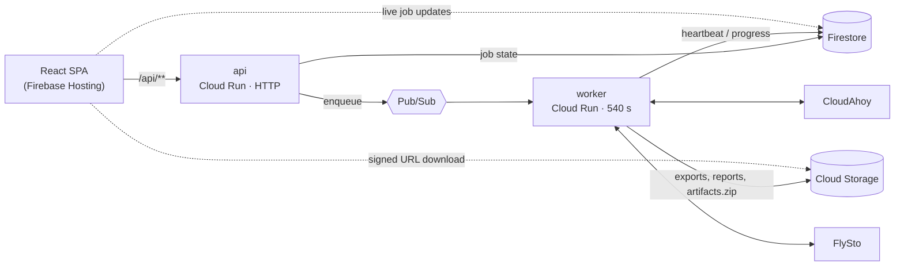

<p align="center">
  
</p>

<h1 align="center">Skybridge</h1>

<p align="center">
  Migrate your <strong>CloudAhoy</strong> flight history into <strong>FlySto</strong> — with a review step before anything is written.
</p>

<p align="center">
  <a href="https://skybridge.inspirespace.co"><strong>▶ Use it now: skybridge.inspirespace.co</strong></a>
</p>

<p align="center">
  <a href="https://github.com/inspirespace/skybridge/actions/workflows/ci.yml"></a>
  <a href="LICENSE"></a>
  
  
  
</p>

---

## What it does

Pilots who switch from CloudAhoy to FlySto have no built-in way to bring their flight history along. Skybridge does it in three steps:

1. **Connect** — enter CloudAhoy and FlySto credentials (validated, encrypted, short-lived).
2. **Review** — Skybridge fetches every flight from CloudAhoy and builds a summary: dates, aircraft, crew, remarks, and what will be uploaded. Nothing is written to FlySto yet.
3. **Import** — after you approve, flights are uploaded to FlySto and then reconciled so aircraft registrations, crew, remarks and tags end up on the right logs. A per-flight import report and all exported files are available for download.

It runs as a hosted web app at **[skybridge.inspirespace.co](https://skybridge.inspirespace.co)**, and the same migration engine is available as a self-contained CLI.

## Architecture



- **Two services, one codebase.** Firebase Functions 2nd gen deploys an HTTP `api` (60 s budget) and a Pub/Sub `worker` (540 s). Anything that can outlive an HTTP request runs in the worker.
- **Jobs are a Firestore state machine:** `review_queued → review_running → review_ready → import_queued → import_running → completed | failed`. The SPA subscribes to the job document, so progress shows up without polling.
- **Framework-agnostic core.** `src/core/` holds the CloudAhoy and FlySto clients and the migration logic. Both the CLI and the cloud worker call into it; `src/backend/` only adds Firebase, auth and orchestration.

## Engineering notes

A few problems that shaped the design — the details are in [`CLAUDE.md`](CLAUDE.md) and [`docs/backend-architecture.md`](docs/backend-architecture.md).

- **Recovering from worker crashes.** Every long operation ticks `heartbeat_at`, including a background heartbeat thread for when a single FlySto request blocks for minutes. When the API sees a stale job it first checks the persisted import report: if every flight already succeeded, the job is marked `completed` rather than failed. Otherwise it re-enqueues the job a bounded number of times.
- **Idempotent, resumable finalization.** After upload, four reconcile passes (resolve log IDs → aircraft → crew → remarks/tags) each mark items as done, so a retried job skips finished work. Crew is applied a second time after FlySto finishes processing, because FlySto can clear it during ingestion.
- **A tight memory budget.** The worker is designed to fit in 256 MiB: uploads stream from tempfiles, client caches are trimmed after each flight, and export files are removed once they are in object storage. The import report is parsed once and shared across all reconcile passes.
- **Downloads without timeouts.** Building a multi-flight zip on request exceeded Cloudflare's 100 s edge limit. The worker now builds `artifacts.zip` at the end of an import, and the API returns a short-lived V4 signed URL so the browser downloads straight from Cloud Storage.
- **Credentials handled carefully.** Third-party credentials are encrypted with Fernet, held behind single-use tokens with a short TTL, and job data expires after 7 days. Firestore and Storage rules deny client writes; sign-in is passwordless email link with optional App Check.

## Tech stack

| Layer | Technology |
| --- | --- |
| Frontend | React 19, TypeScript, Vite, Tailwind CSS, shadcn/ui |
| Backend | Python 3.11 on Firebase Functions 2nd gen (Cloud Run) |
| Data & messaging | Firestore, Cloud Storage, Pub/Sub |
| Auth | Firebase Auth (passwordless email link), optional App Check |
| Testing | pytest with coverage, Vitest, Playwright |
| Tooling | uv, npm, Dev Containers, Docker Compose, Firebase emulators, Caddy (local HTTPS) |

## Getting started

### Use the hosted app

Go to **[skybridge.inspirespace.co](https://skybridge.inspirespace.co)**, sign in with your email, and follow the steps. No installation needed.

### Run the CLI

The guided CLI walks you through the same review → approve → import flow in the terminal, prompting for date range, flight limit and export formats:

```sh
uv sync
./cloudahoy2flysto
```

Each run writes its review, import report, exports and SQLite state to `data/runs/<RUN_ID>/`. To resume an interrupted run instead of starting a new one, set `RUN_ID` to that run's directory name, e.g. `RUN_ID=20260101T120000Z ./cloudahoy2flysto`.

The wrapper always runs guided mode. For scripted use, call the CLI module directly. That mode supports `--review`, `--approve-import`, `--dry-run`, `--verify-import-report` and `--reconcile-import-report`:

```sh
PYTHONPATH=src uv run python -m core.cli --help
```

### Run the full stack locally

Requirements: Docker and [mkcert](https://github.com/FiloSottile/mkcert) for local HTTPS certificates.

```sh
docker compose --profile dev up --build
```

Then open https://skybridge.localhost. This starts the Firebase emulators (Auth, Firestore, Functions, Hosting, Pub/Sub, Storage), the API, the worker and the frontend behind an HTTPS proxy. Mock CloudAhoy and FlySto services are available for offline development (`DEV_USE_MOCKS=1`).

Certificate setup, devcontainer usage and the production-like profile are covered in [docs/local-development.md](docs/local-development.md).

## Testing

```sh
uv sync --extra dev                            # installs pytest + pytest-cov
uv run pytest                                  # backend + CLI (~350 tests, coverage in CI)
npm --prefix src/frontend run test -- --run    # frontend unit tests (Vitest)
npm --prefix src/frontend run test:e2e         # end-to-end (Playwright)
```

CI runs pytest with coverage on every push and pull request. See [docs/testing.md](docs/testing.md) for running everything inside the devcontainer.

## Deployment

```sh
./scripts/firebase-deploy.sh
```

One script, used both locally and by the manual GitHub Actions workflow. It reads the project from `.firebaserc` and deploys Functions, Hosting and Firestore config. Before changing anything remote it checks prerequisites: it creates the Firestore database if missing, resolves the web app config, verifies auth providers and authorized domains, grants the IAM role needed for signed URLs, and runs a frontend runtime smoke test.

Environment variables, IAM requirements and the production checklist are in [docs/production.md](docs/production.md).

## Repository layout

```
src/core/       Migration engine + CLI: CloudAhoy client, FlySto client, review/import logic
src/backend/    HTTP handlers, job orchestration, Firestore/GCS/Pub/Sub glue, auth, crypto
src/frontend/   React SPA and static landing/legal pages
functions/      Firebase Functions entry points (api + worker)
tests/          Backend and CLI test suite (pytest)
scripts/        Deploy, cleanup and dev helpers
docs/           Architecture, frontend, testing and production docs
```

## Documentation

- [Codebase overview](docs/codebase-overview.md): where things live
- [Backend architecture](docs/backend-architecture.md): serverless flow, Firestore/Storage/Pub/Sub design
- [Frontend](docs/frontend.md): entry points and Firebase Auth setup
- [Local development](docs/local-development.md): Docker stack, emulators, HTTPS certs
- [Testing](docs/testing.md)
- [Production](docs/production.md): env vars, IAM, deploy checklist

## About this project

Skybridge is built and run by [Inspirespace](https://www.inspirespace.co). The code is written entirely by AI coding agents (Claude Code, Codex) under human direction and review. The repository is an example of what that workflow produces when it is held to normal engineering standards: tests, CI, documented architecture, and production operation.

Skybridge is not affiliated with CloudAhoy or FlySto. Contributions are welcome; see [CONTRIBUTING.md](CONTRIBUTING.md).

## License

[Apache-2.0](LICENSE)
